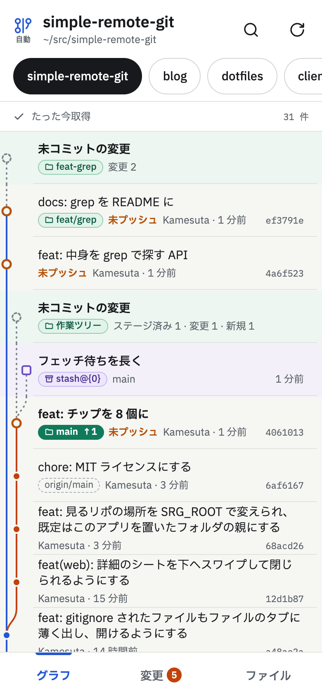
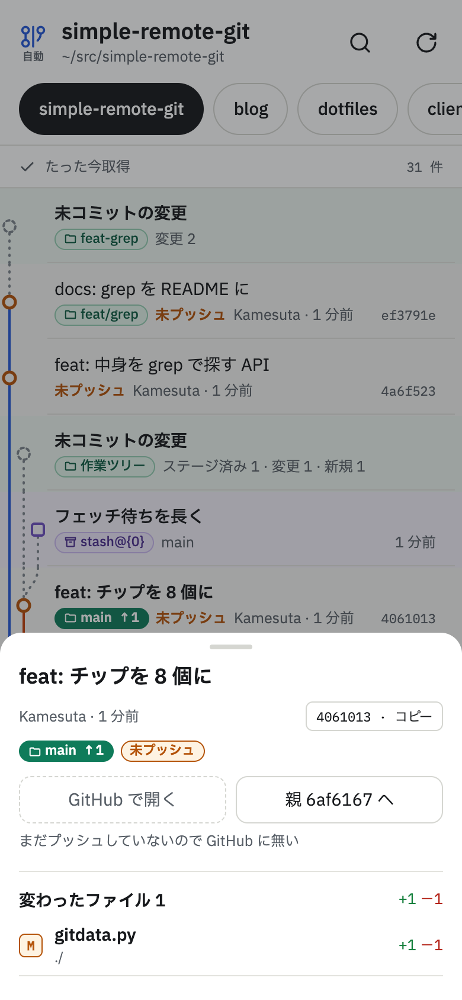
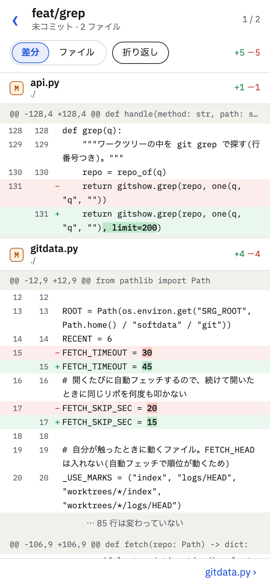
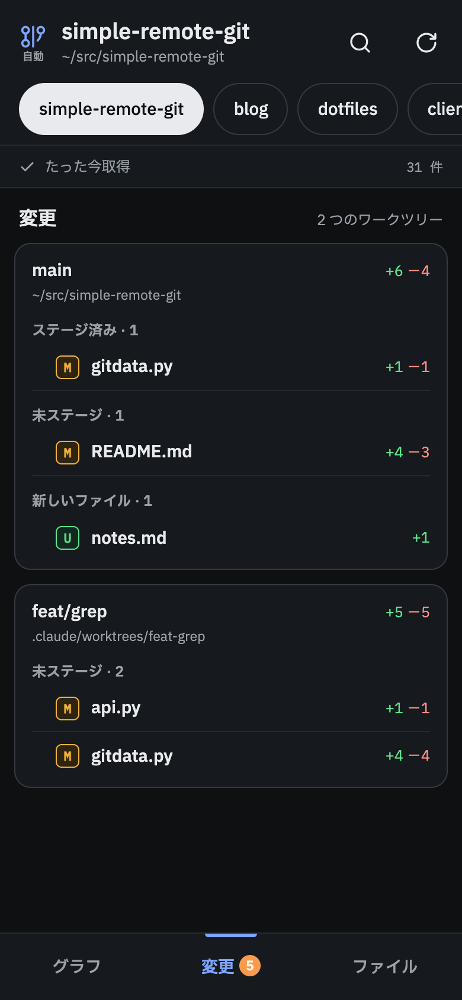
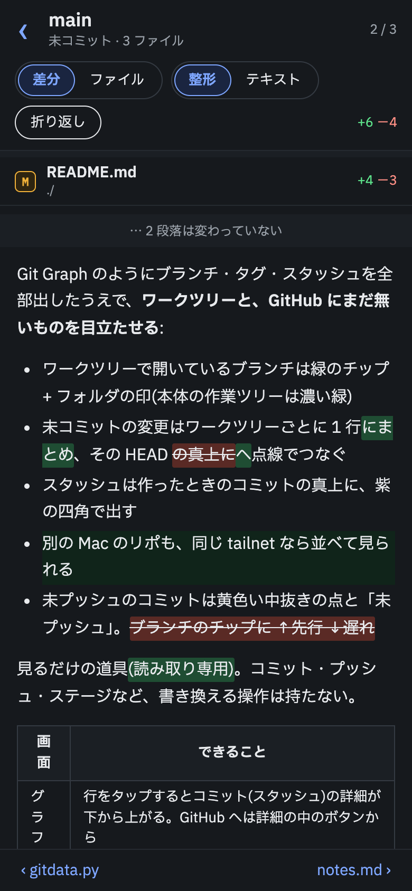
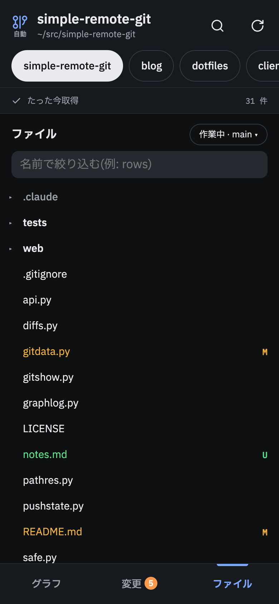

# simple-remote-git

**スマホで見る Git Graph。** Mac で小さなサーバーを立て、Tailscale 越しにスマホのホーム画面から開く。
寝転がりながら、Claude Code などに任せた作業の進み具合 ― どのワークツリーで何を変えたか、何がまだプッシュされていないか ― を眺められる。

<p align="center">
  
  
  
</p>

## ✨ ウリ

- **📱 スマホのための縦スクロール** ― 開いたら裏で `git fetch` して描き直す。最近触ったリポ 6 個をチップで切り替え
- **🌿 GitHub にまだ無いものが一目で** ― ワークツリーごとの未コミットの変更、スタッシュ、未プッシュのコミット、ブランチの ↑先行 ↓遅れ
- **🔍 差分をその場で流し読み** ― 未プッシュのコミットも、未コミットの変更も、スタッシュも。変わったファイルを縦につないで出し、一覧で選んだファイルの所へ飛ぶ。変わった語だけ濃く塗る。プッシュ済みなら GitHub へも 1 タップ
- **📝 Markdown は GitHub の Rich Diff と同じ見え方** ― 整形したものどうしを比べ、足した塊は緑、消した塊は赤、直した段落は語の単位で。変わっていない段落は畳む。プレーンテキストにも切り替えられる
- **📋 パスを貼るだけで開く** ― AI の返事にある `web/app.js:120` やフルパスを貼れば、そのファイルのその行へ。別のリポやワークツリーでも
- **🗂 ファイルブラウザと履歴** ― 差分の無いフォルダも木でたどれる(gitignore されたものも薄く)。ファイルを変えたコミットの一覧へも
- **🪶 依存ゼロ** ― Python の標準ライブラリと素の HTML/JS だけ。ビルドも `npm install` も venv も要らない
- **👀 見るだけ** ― コミット・プッシュなど書き換える操作は持たない。`git status` も index を書き換えない形で叩く

<p align="center">
  
  
  
</p>

## 🚀 使い方

要るもの: Python 3.10 以上・git・tmux・[Tailscale](https://tailscale.com)(tailnet で HTTPS を有効にしておく)。Mac で使っている。

```sh
cd ~/src                     # リポを並べている場所に clone する(その隣のリポが並ぶ)
git clone https://github.com/Kamesuta/simple-remote-git.git
ln -s "$PWD/simple-remote-git/serve.sh" ~/.local/bin/graph-share   # PATH の通った場所に
graph-share                  # tmux で立て、tailnet にだけ出して URL を表示
```

出た URL(`https://<Mac の名前>.<tailnet>.ts.net:7443/`)をスマホで開き、ホーム画面に追加すればアプリのように開ける。

| コマンド | すること |
| --- | --- |
| `graph-share` | 立てて URL を出す(立っていれば URL を出し直すだけ) |
| `graph-share stop` | 畳む(tailscale serve は 7443 だけ外す) |
| `graph-share attach` | tmux に入ってログを見る |

- 見るリポの場所を変えるときは `SRG_ROOT=~/work graph-share`。束ねるだけのフォルダ(`games/server` のような形)は 1 階層潜って探す
- Tailscale を使わず手元で試すなら `python3 server.py` で http://127.0.0.1:7420/

> [!WARNING]
> tailnet の中の端末からは、`SRG_ROOT` の下のリポのファイルを **gitignore されたもの(`.env` など)も含めて** 読める。
> サーバーは 127.0.0.1 だけで待ち、外へは `tailscale serve` で tailnet の中にだけ出す(Funnel は使わない)。
> 人と共有している tailnet なら、ACL で自分の端末だけに絞ること。

## 🛠 開発

```sh
python3 -m unittest discover tests
node --test tests/*.test.mjs
```

サーバーは `server.py`(受け口)と `api.py`(`/api/*` の表)から読むと早い。画面は `web/app.js` から。
`SRG_PORT` で待つポートを変えられるので、試しのリポを並べた `SRG_ROOT` と組み合わせて別に立てられる。

## 📄 ライセンス

[MIT](LICENSE)。同梱している [marked](https://marked.js.org)(MIT)と [DOMPurify](https://github.com/cure53/DOMPurify)(Apache-2.0 / MPL-2.0)は `web/vendor/` にそれぞれのライセンスと置いてある。アイコンの線は [Lucide](https://lucide.dev)(ISC)。
